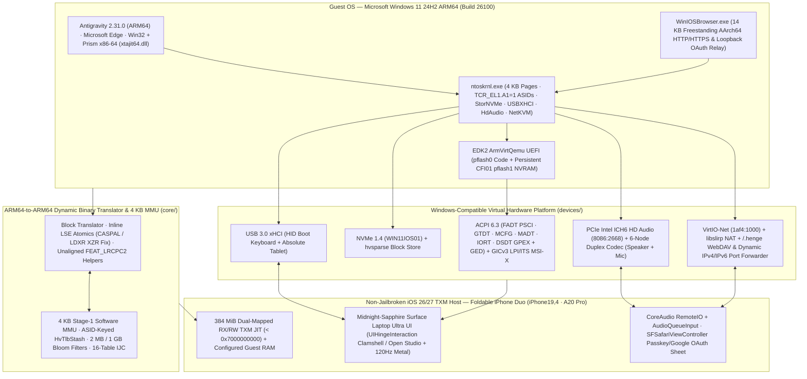

# WindowsiOS

Windows 11 **24H2 ARM64** on iPad and the original iPhone Duo interface, using
an ARM64 translation engine and debugger-assisted JIT.

**Current status: the universal arm64 iOS app compiles and signs successfully.
The latest features are build-verified only. Windows installation/boot, device
input, Internet access, TPM recognition and dynamic resolution remain unverified.**
No near-native performance result is claimed for this update.

Canonical branch: [`main`](https://github.com/Thomas20090425/Windows-on-iOS/tree/main).
Latest implementation revision: [`661b8ae`](https://github.com/Thomas20090425/Windows-on-iOS/commit/661b8ae).
Start with [the agent handoff](AGENT_HANDOFF.md) to continue development, or
[the changelog](CHANGELOG.md) for the complete change history.

## Download and build

[**Download the complete source ZIP**](https://github.com/Thomas20090425/Windows-on-iOS/archive/refs/heads/main.zip),
unzip it, and double-click **[Build.command](Build.command)** on your Mac.
Install full Xcode with its iOS SDK and Homebrew first. The command checks the
Xcode setup, installs missing Homebrew build tools, downloads/builds the
required dependencies and produces `distribution/WindowsiOS.app` with two
build workers. The first build needs Internet access and can take some time.

The default is an **unsigned compile build**. Installing on your iPad/iPhone
requires your own Apple development signing team and provisioned device; see
[build and signing](#build-and-launch-from-a-mac). The command does not run
tests, launch a VM or install anything on a device.

All application/engine source, dependency preparation scripts and build
configuration are in the repository. The Xcode project is generated from the
tracked `ios/project.yml`; generated projects, downloaded dependencies and
compiled app/IPA files are excluded from Git and recreated by the build.
Your Windows ISO is supplied separately.

## What the current app includes

| Area | Implemented behavior and limits |
| --- | --- |
| Universal interface | Native iPad VM library, session and settings, with the original Duo presentation retained. Build targets iOS 17+; runtime eligibility and JIT still depend on the device/OS. |
| ISO-only setup | Import your own Windows 11 24H2 ARM64 ISO, choose a 64–512 GiB disk, and let the app create the sparse disk, private UEFI variables and guarded unattended setup media. Firmware and Windows driver media are bundled. |
| TPM 2.0 | Real libtpms software TPM, firmware FIFO/TIS and Windows CRB/ACPI discovery, with persistent state per VM. This is software TPM support; no hardware-backed attestation or successful Windows enrollment is claimed. |
| RAM | Enter any whole MiB from 4096 to the displayed device limit, leaving 3072 MiB physical host headroom and respecting the board map. An existing JIT reservation requires relaunch to change. |
| CPU identity | Consistent **Arm Cortex-A76 r4p1 (virtual)** in the app and guest platform tables. The model name describes the virtual CPU. |
| Mouse and keyboard | Revised left/right/middle button handling, persistent held-button state and F1–F12 guest keys. A floating F keys button opens a hideable row over Windows without shrinking the display. Physical behavior needs device verification. |
| Apple Pencil | Tip contact and supported hover act as pointer input. Pressure, tilt, eraser and Windows Ink pen identity need a future virtual digitizer implementation. A driver alone cannot add them. |
| Networking | libslirp NAT with bundled official ARM64 NetKVM drivers and improved backend/error handling. Enable NAT in VM settings. Actual guest Internet access is unverified. |
| Display | VirtIO GPU **2D**, native-screen/window-fit/preset resolutions and preferred-mode changes through the bundled Windows service. Firmware keeps RAMFB. No accelerated 3D/DirectX or Apple GPU passthrough. |
| Mac JIT | UUID-matched local symbols, readiness handshake, progress reporting, batched USB debugger writes and bounded attach startup. A post-fix completion time has not been measured. |
| VM deletion | Delete old machines with confirmation in the library. Running or engine-retained machines are protected until app relaunch. |

## Set up Windows

1. Install a development-signed app on a provisioned, supported device.
2. Choose **New Machine**, enter the name/disk capacity, and select **Import
   Windows ISO and Create**. Supply an ARM64 ISO; no separate firmware,
   variable-store, disk-image or driver download is needed.
3. Set the RAM, NAT and display options before starting. Initialize JIT using
   the Mac launcher below, then select the VM and **Start** in the app.
4. The app supplies guarded partition/install answers only for its own newly
   created blank disk. Complete any Windows Setup/OOBE prompts and provide your
   own Windows license. Automatic installation remains runtime-unverified.

For an **existing Windows VM**, update the app, open the **WINIOSDRVS** drive
inside Windows, and run **InstallDrivers.cmd** as administrator once. Restart
Windows if prompted. This installs NetKVM, the display driver and the official
resolution service; it does not require reinstalling Windows. See
[network/driver/display setup](docs/WINDOWS_DRIVERS_AND_DISPLAY.md).

Back up the Windows disk, `vars.fd`, the VM's `TPM/` directory and
`tpm-state-initialized` marker together. Replacing established TPM state can
break access to keys protected by it. Full engine teardown, suspend and
snapshots are unavailable; another VM session requires an app relaunch.

## Build and launch from a Mac

Use full Xcode with its iOS SDK and Homebrew. Double-click **Build.command**
in the downloaded folder, or run it from Terminal after cloning `main`:

```sh
git clone https://github.com/Thomas20090425/Windows-on-iOS.git
cd Windows-on-iOS
./Build.command
```

The entry point prepares missing build tools and calls the existing compile
script. It keeps **two build workers** by default. If macOS asks how to open
the downloaded command, open it with Terminal or run `bash Build.command` in
that folder. See [the installation guide](IPAD_INSTALLATION.md) for prerequisites.

That produces an unsigned compile artifact. To build a development-signed app
and IPA, use your own signing team/profile and registered device:

```sh
DEVELOPMENT_TEAM=YOUR_TEAM_ID JOBS=2 ./Build.command
```

If the build tools are already installed, the direct compile entry point remains
`JOBS=2 ./scripts/build_ios_app.sh`. Both paths prepare pinned firmware, TPM
dependencies and ARM64 driver resources automatically.

Outputs are `distribution/WindowsiOS.app`,
`distribution/WindowsiOS-development.ipa` for a signed build, and
`distribution/BUILD_INFO.json`. Build products, signing profiles, Windows media
and VM data are ignored by Git; a fresh checkout must build/sign its own app.

The following installation and launch commands are for the device owner to
run when ready. Keep the device trusted, unlocked and connected by USB, with
Developer Mode enabled. Use the exact local app bundle installed on the device:

```sh
./scripts/install_on_device.sh DEVICE_ID distribution/WindowsiOS.app
./scripts/launch_on_device.sh DEVICE_ID me.ammaar.windowsios distribution/WindowsiOS.app
```

The launcher prepares its pinned Python environment on first use. Keep its
terminal open, select a VM and press **Start** when prompted. Ordinary Xcode
Run does not perform the custom JIT handshake. Reinstall a rebuilt app before
using its matching local symbols. Current batched preparation still covers the
entire 384 MiB JIT region; the earlier serial methods were slow, and the new
path has no confirmed completion-time measurement. See
[JIT troubleshooting and known limits](AGENT_HANDOFF.md).

## Build evidence and documentation

The latest **Release** build used Xcode 26.6, iOS SDK 26.5, generic arm64
`iphoneos`, device families 1 and 2, and two workers. The log
`build/logs/ios-app-build-network-display-signed.log` ends in `BUILD SUCCEEDED`;
signature/package checks passed. The local development IPA SHA-256 is
`5251bfa1a41465efcb1e7898412bdabd8effc79bc1097aaceb2c918bd9214d70`.
The latest Debug evidence covers an earlier startup/deletion milestone only.

**Development constraint: build only on this Mac. Do not run tests, simulators,
debuggers, the app, VMs, profiling or benchmarks unless the owner changes this
instruction.** Documentation updates do not rebuild or revalidate the app.

| Document | Purpose |
| --- | --- |
| [AGENT_HANDOFF.md](AGENT_HANDOFF.md) | Portable context, source map, exact state, constraints, unresolved work and a continuation prompt for another agent. |
| [CHANGELOG.md](CHANGELOG.md) | All implementation/documentation milestones and GitHub commit links. |
| [IPAD_INSTALLATION.md](IPAD_INSTALLATION.md) | Prerequisites, signing, installation, ISO setup, controls and troubleshooting. |
| [VALIDATION_REPORT.md](VALIDATION_REPORT.md) | Compile/package evidence and explicit runtime gaps. |
| [PROGRESS_LOG.md](PROGRESS_LOG.md) | Detailed chronological implementation record. |
| [Windows drivers and display](docs/WINDOWS_DRIVERS_AND_DISPLAY.md) | Existing-VM driver installation, NAT, native resolution and 2D graphics limits. |
| [TPM provenance](docs/TPM_PROVENANCE.md) | libtpms/OpenSSL pins, state handling, entropy patch and licensing. |
| [Firmware provenance](docs/FIRMWARE_PROVENANCE.md) | Matched EDK2 code/variable template, hashes and licenses. |
| [UTM configuration review](docs/UTM_CONFIGURATION_REVIEW.md) | Configuration mapping and engine differences. |
| [Third-party notices](THIRD_PARTY_NOTICES.md) | Upstream attribution and dependency licenses. |

To continue with another agent, share `main` and ask it to read
`AGENT_HANDOFF.md`, `README.md` and `VALIDATION_REPORT.md` before editing. The
handoff includes a ready-to-copy prompt; it preserves context independently of
this conversation.

Source files retain their stated licenses, including GPL-2.0-or-later. The
combined iOS build with OpenSSL 3 uses the GPL-3.0-or-later option; see
[the linking notice](licenses/TPM-LINKING-NOTICE.txt) and
[third-party notices](THIRD_PARTY_NOTICES.md). Windows installation media and
licenses are supplied by the user.

<details>
<summary>Upstream showcase and historical engineering notes</summary>

The following material is preserved from the upstream project. Its screenshots,
performance statements, device claims and older provisioning commands were not
reproduced or validated in this update. Use the current setup instructions above
and the linked handoff; historical raw-disk/firmware-import procedures and old
fixed RAM values are superseded.

## Visual Showcase

<table>
  <tr>
    <td align="center" width="50%">
      
      <br />
      <sub><b>Physical iPhone Duo (<code>iPhone19,4</code>):</b> Windows 11 24H2 ARM64 Desktop with native ARM64 <b>Antigravity 2.31.0</b>, full-duplex Intel HD Audio (Speaker + Mic), and active VirtIO Ethernet.</sub>
    </td>
    <td align="center" width="50%">
      
      <br />
      <sub><b>Antigravity 2.31.0 (Native Windows ARM64):</b> Multi-process Electron/Chromium IDE running live inside the 4 KB software-MMU ARM64-to-ARM64 JIT.</sub>
    </td>
  </tr>
  <tr>
    <td align="center" width="50%">
      
      <br />
      <sub><b>Physical iPhone Duo:</b> Unmodified ARM64 Microsoft Edge running with WHQL <code>NetKVM</code> VirtIO Ethernet over rootless <code>libslirp</code> NAT.</sub>
    </td>
    <td align="center" width="50%">
      
      <br />
      <sub><b>Live TLS 1.3 / HTTPS Web Rendering:</b> Microsoft Edge rendering Wikipedia over user-mode NAT with zero host entitlements.</sub>
    </td>
  </tr>
  <tr>
    <td align="center" colspan="2">
      
      <br />
      <sub><b>Native iOS <code>SafariSheet</code> OAuth Bridge:</b> <code>WinIOSBrowser.exe</code> registered as the <code>UCPD.sys</code>-verified default <code>HTTP</code>/<code>HTTPS</code> handler, relaying <code>localhost</code> OAuth callbacks between iOS <code>SFSafariViewController</code> (Passkeys / Face ID / Google sessions) and Windows apps.</sub>
    </td>
  </tr>
</table>

---

## What Didn't Exist Before This

Prior to `WindowsiOS`, booting and interactively using **unmodified retail Microsoft Windows 11 24H2 ARM64** (`Build 26100`) — complete with **Microsoft Edge**, **Antigravity `2.31.0`**, **Prism x86-64 emulation (`xtajit64.dll`)**, **full-duplex Speaker + Microphone audio**, and **passkey-capable Google OAuth** — at near-native speed on **non-jailbroken modern iOS** did not publicly exist:

1. **No Hardware Hypervisor on Stock iOS:** Apple restricted `com.apple.developer.kernel.hypervisor` (`Hypervisor.framework`) on stock iOS starting in iOS 16.4+, permanently cutting off hardware EL2 virtualization (`UTM HV`) on non-jailbroken iPhones and iPads. On iOS 26 and iOS 27 hardware (such as the A20 Pro), Apple's **Trusted Execution Monitor (TXM)** additionally enforces strict hardware page-table signing against arbitrary `MAP_JIT` execution.
2. **Interpreter Emulators Are 5–10× Too Slow for Windows 11 24H2:** Sideloaded and App Store emulators such as **UTM SE** fall back to QEMU's **TCG threaded interpreter** (`TCI`). Under interpretation, modern Windows 11 24H2 takes tens of minutes to reach the desktop and cannot interactively drive heavy multi-process Chromium/Electron stacks like Microsoft Edge or Antigravity.
3. **ARM64 Binary Translation Existed Only for macOS / Linux Guests — Not Windows NT:** [`Leviidev/Henge`](https://github.com/Leviidev/Henge) proved that an EL1&0 ARM64-to-ARM64 dynamic binary translator paired with a software MMU and TXM dual-mapped JIT could run macOS (`vmapple`, 16 KB pages) at near-native speed on modern iPhones. However, no open-source engine combined TXM ARM64-to-ARM64 JIT translation with everything the **Windows NT ARM64 kernel (`ntoskrnl.exe`)** demands:
   - Strict **4 KB stage-1 translation granules** (`TG0`/`TG1`) running on a 16 KB Darwin host;
   - Windows NT's **`TCR_EL1.A1 = 1`** ASID placement in `TTBR1_EL1[63:48]` and transient `ASID 0` transitions inside `KiSwapProcess`;
   - Windows 11's **Prism (`xtajit64.dll`)** unaligned `FEAT_LRCPC2` (`LDAPUR`/`STLUR`) memory ordering semantics (`SCTLR_EL1.nAA = 1`);
   - A full **UEFI + ACPI 6.3 + GICv3 LPI/ITS MSI-X + PCIe NVMe + USB 3.0 xHCI + Intel ICH6 HD Audio + WHQL VirtIO-Net** PC platform fitting comfortably inside iOS's Jetsam memory envelope.

---

## Standing on the Shoulders of Giants — Upstream Credits

`WindowsiOS` would not exist without the trailblazing open-source work of the iOS virtualization, binary-translation, and firmware communities. Full license notices and attributions are documented in [`THIRD_PARTY_NOTICES.md`](THIRD_PARTY_NOTICES.md):

- **[`Leviidev/Henge`](https://github.com/Leviidev/Henge) & [`Leviidev/Henge#7`](https://github.com/Leviidev/Henge/pull/7)** (`GPL-2.0-or-later`) — Foundational ARM64-to-ARM64 dynamic binary translator (`HengeVM`), stage-1 software MMU and indirect-branch/return cache design, multi-touch trackpad concepts, `/.henge/` WebDAV guest-host transport (`host/share.c`), and the iOS 26/27 TXM dual-mapped JIT substrate (`winios_jit.c`, `winios_brk.S`, `henge-jit.js`).
- **[`Leviidev/Husk`](https://github.com/Leviidev/Husk)** (`GPL-2.0-or-later`) — ARM64 binary translation architecture, iOS `libslirp` cross-compilation patches, and on-device JIT helper insights.
- **[`mxhm11cr/LinuxRunner`](https://github.com/mxhm11cr/LinuxRunner)** (building on [`ish-app/ish`](https://github.com/ish-app/ish) & [`rcarmo/ios-linuxkit`](https://github.com/rcarmo/ios-linuxkit)) — Early ARM64 guest OS bring-up patterns and iOS runtime/Jetsam discipline.
- **[`StephenDev0/StikDebug`](https://github.com/StephenDev0/StikDebug) / `StikJIT`** (`MPL-2.0` / `BSD-3-Clause`) & **[`jkcoxson/idevice`](https://github.com/jkcoxson/idevice)** (`MIT`) — On-device iOS 26/27 TXM debugger attachment, `universal.js` (`BRK #0x69` / `BRK #0xF00D`) RX/RW page-blessing, and `CS_DEBUGGED` ledger-exempt memory enablement.
- **[`libslirp`](https://gitlab.freedesktop.org/slirp/libslirp)** (`BSD-3-Clause`) — Rootless user-mode TCP/IP, DHCP, and DNS NAT stack (`host/net_slirp.c`).
- **[TianoCore EDK2 `ArmVirtQemu`](https://github.com/tianocore/edk2)** (`BSD-2-Clause-Patent`) — `AARCH64` UEFI firmware (`QEMU_EFI.fd`, fetched locally at provisioning time).
- **[Red Hat `virtio-win` (`NetKVM`)](https://github.com/virtio-win/kvm-guest-drivers-windows)** (`BSD-3-Clause` / `GPL-2.0`) — WHQL-signed Windows 11 ARM64 VirtIO Ethernet driver (fetched locally at provisioning time).

---

## System Architecture



---

## What Was Original & Hard — Built Here with Gemini 4 Carbon

Bringing unmodified Windows 11 24H2 ARM64 to full interactive life on a non-jailbroken foldable iPhone required solving a chain of deep OS kernel, ARMv8 architecture, PCIe/USB/HDA hardware, and iOS TXM memory problems. Every piece of this bring-up and engineering was built with **Gemini 4 Carbon**:

### 1. Windows NT 4 KB Software MMU & `TCR_EL1.A1 = 1` ASID-Keyed `HvTlbStash` ([`core/mmu.c`](core/mmu.c), [`core/cpu.h`](core/cpu.h), [`core/sysreg.c`](core/sysreg.c))
- **4 KB Granule & CPU Identity:** `ntoskrnl.exe` mandates 4 KB stage-1 translation granules (`HV_TLB_PAGE_BITS = 12`) and validates CPU identification and cycle counters during `KiInitializeKernel`. `core/sysreg.c` exposes an ARM Cortex-A76 r4p1 `MIDR_EL1` (`0x414fd0b1`), calibrated `PMCCNTR_EL0`, and 4-way per-privilege software TLB tables (`[EL0, EL1, EL1+PAN]` packed into single 128-byte cache lines so kernel `PAN` toggles around user copies never flush TLB state), paired with 2 MB and 1 GB large-block Bloom filters (`large_2m_bloom`, `large_big_bloom`) for fast range `TLBI`.
- **The `TCR_EL1.A1 = 1` & `KiSwapProcess` `ASID 0` Trap:** Unlike Linux and macOS (which store the user ASID in `TTBR0_EL1[63:48]`), **Windows 11 ARM64 sets `TCR_EL1.A1 = 1` (bit 22)**, placing the active process ASID in `TTBR1_EL1[63:48]`. Worse, during every context switch (`KiSwapProcess` — **64,800+ switches/sec** under desktop load), Windows writes the new `TTBR0_EL1` (`DirectoryTableBase`) while `TTBR1_EL1`'s ASID transiently transitions through **`ASID 0`**! Keying TLB stashes naively by `TTBR0` or stashing under `ASID 0` either thrashes every user TLB entry on every context switch or leaks stale user mappings across recycled physical `DirectoryTableBase` pages.
- **Solution:** `hv_mmu_ukey()` synthesizes a canonical `(ASID << 48) | (TTBR0 & OA_MASK)` address-space key reading the ASID from `TTBR1` whenever `TCR.A1 == 1` and explicitly returning `0` whenever `ASID == 0`. `HvTlbStash` (`hv_tlb_switch_user`) saves and restores ~266–313 live user TLB slots across context switches in microseconds without re-walking 4-level page tables.

### 2. Inline ARMv8.1 LSE Exclusive Atomics & the Clang `LDXR`/`LDAXR XZR` Bug ([`core/translate.c`](core/translate.c))
- **128-bit `SLIST` (`LDXP`/`STXP` → `LDP` + `CASPAL`):** The Windows NT dispatcher, heap, and I/O manager execute lock-free 128-bit `SLIST` operations (`ExpInterlockedPopEntrySList`) millions of times per second via `LDXP`/`LDAXP` and `STXP`/`STLXP`. Exiting to C on every pair-exclusive crippled boot performance; `translate_excl_pair()` lowers 64-bit and 128-bit exclusives directly into inline Apple Silicon `LDP` + ARMv8.1 LSE `CASPAL` fast paths.
- **The Subtle `rt == 31` (`LDXR XZR`) Deadlock/Corruption:** Clang-compiled C++ code inside Chromium (`msedge.dll`) and Electron (`Antigravity.exe`) frequently emits `ldxr xzr, [rn]; stlxr ws, xt, [rn]` (`rt == 31`) to arm the exclusive monitor without keeping the old value in a general-purpose register. In AArch64 machine code, register `31` encodes `XZR` in `LDXR` but encodes **`SP`** in `MOV`/`ADD` instructions — and if `HV_CPU_EXCL_VAL` is not populated with the true loaded memory word before checking `rt != 31`, either guest `SP` gets clobbered or `STLXR`'s `CASAL` compare-and-swap perpetually fails whenever `[rn] != 0`, deadlocking renderer threads. `translate_excl()` always loads into scratch `x6`, records `x6` into `HV_CPU_EXCL_VAL`, and suppresses register writeback when `rt == 31`.

### 3. Windows Prism (`xtajit64.dll`) Unaligned `FEAT_LRCPC2` Emulation ([`core/translate.c`](core/translate.c), [`core/memop.c`](core/memop.c))
- Windows 11 ARM64's **Prism** x86-64 binary translator (`xtajit64.dll`) executes with `SCTLR_EL1.nAA = 1` (non-aligned access permitted on Weakly-Ordered RCpc instructions) and emits unaligned **`LDAPUR` / `STLUR` / `LDAPR`** (`FEAT_LRCPC` / `FEAT_LRCPC2`) loads and stores to emulate x86-64 TSO memory ordering on packed x86 data structures.
- Darwin/XNU on Apple Silicon enforces **`SCTLR_EL1.nAA = 0`** in EL0 user space — executing a native `LDAPUR` or `STLUR` on an unaligned host address immediately kills the host process with **`SIGBUS` (`EXC_ARM_DA_ALIGN`)**.
- `translate_mem_impl()` enforces an inline alignment mask (`host_align`) on `HV_MEM_ORDERED` accesses: aligned RCpc instructions execute natively inline in 1 instruction (stripping `imm9` once `A` holds the effective host address), while unaligned accesses branch seamlessly out-of-line to acquire/release-fenced software helpers in `core/memop.c`.

### 4. Full Windows-Compatible Virtual Hardware Platform ([`devices/`](devices/))
Windows 11 24H2 refuses FDT/DeviceTree boot and demands a compliant ServerReady/PC-class UEFI + ACPI + MSI-X topology:
- **UEFI + Persistent CFI01 NVRAM ([`devices/pflash.c`](devices/pflash.c), [`devices/fw_cfg.c`](devices/fw_cfg.c), [`devices/fb_metal.m`](devices/fb_metal.m)):** Dual 64 MB flash banks (`pflash0` read-only `HvRam` code at `0x00000000` + `pflash1` persistent Intel CFI01 NVRAM at `0x04000000` so `bcdboot` `Boot0001` entries survive reboots) plus `ramfb` double-buffered 120 Hz Metal presentation.
- **Programmatic ACPI 6.3 + GICv3 ITS ([`devices/acpi.c`](devices/acpi.c), [`devices/gicv3.c`](devices/gicv3.c)):** Synthesizes `RSDP`, `XSDT`, `FADT` (HW-reduced ACPI + `PSCI` `HVC`), `GTDT`, `MCFG` (PCIe ECAM at `0x4010000000`), `MADT` (`GICD`, per-CPU `GICR`, and `GIC ITS` `0x0F` at `0x08080000`), **`IORT`** (mapping PCIe Root Complex RIDs `0x0000..0xFFFF` to `GICv3 ITS#0` so Windows arms MSI-X LPIs cleanly), and `DSDT` (`PNP0A08` GPEX Root Complex + `ACPI0013` GED power button).
- **NVMe 1.4 + `USBXHCI.SYS`-Compliant USB 3.0 xHCI + WHQL `virtio-net` ([`devices/nvme.c`](devices/nvme.c), [`devices/xhci.c`](devices/xhci.c), [`devices/virtio_net.c`](devices/virtio_net.c)):**
  - PCIe endpoints advertise **Root Complex Integrated Endpoint (`0x0092`)** capabilities so `pci.sys` accepts bus-0 devices without root ports.
  - `nvme.c` implements admin/I/O queues, PRP lists, MSI-X, serial `WIN11IOS01`, and deferred flush synchronization (`hv_disk_sync()`) so NTFS metadata bursts don't stall iOS flash storage.
  - `xhci.c` implements **Event Data TRB (`ED = 1`) cumulative transfer-length tracking (`EDTLA`)** and `CC_STALL` endpoint-halt recovery strictly required by Windows's `USBXHCI.SYS`, exposing Port 1 Boot Keyboard (`0627:0002`) and Port 2 Absolute Touch/Trackpad Tablet (`0627:0001`).

### 5. From-Scratch PCIe Intel ICH6 Full-Duplex HD Audio ([`devices/hda.c`](devices/hda.c), [`host/audio_mac.c`](host/audio_mac.c))
- Red Hat's `virtio-win` suite has **no** Windows `virtio-snd` driver. To achieve zero-driver-install plug-and-play audio in Windows 11 ARM64, we built a complete **Intel ICH6 High Definition Audio PCIe controller (`8086:2668`, `PCI\CC_0403`)** from scratch in `devices/hda.c` paired with a 6-node Full-Duplex HDA Codec (`1af4:0022`):
  - `NID 0` Root → `NID 1` Audio Function Group → `NID 2` Stereo DAC + `NID 3` Speakers Pin Complex (`0x01114010`) + `NID 4` Stereo ADC + `NID 5` Microphone Pin Complex (`0x01a19020`).
  - Full CORB/RIRB verb ring engines, 24.000 MHz `WALCLK`, DMA Position Buffer (`DPLBASE`/`DPUBASE`), `LPIB`, and scatter-gather BDL streams.
- Windows 11 binds inbox `hdaudbus.sys` + `HdAudio.sys` automatically on first boot, streaming lock-free 48 kHz S16LE playback to iOS `RemoteIO` (`AudioUnit`) and live microphone capture from iOS `AudioQueueNewInput` (`AVAudioSessionCategoryPlayAndRecord`).

### 6. 384 MiB TXM Dual-Mapped JIT + Configured Guest RAM ([`ios/Sources/Native/winios_jit.c`](ios/Sources/Native/winios_jit.c), [`scripts/optimize_windows_lite.py`](scripts/optimize_windows_lite.py))
- **TXM low-address reservation and configured RAM:** The iOS allocator reserves low address space before the debugger requests its **384 MiB RX/RW JIT**. During the matching helper session it attempts `hv_alloc_no_footprint` for the selected whole-MiB guest RAM allowance, leaving 3 GiB physical host headroom. Allocation and the memory-ledger behavior are OS-dependent; the app checks the actual reservation and does not promise immunity from Jetsam or silently reduce the selected RAM.
- **Current Windows cleanup:** Optional consumer-app and visual cleanup preserves Defender, SmartScreen, Windows Update, code integrity and CPU mitigations. It no longer invokes the legacy security-disabling hive helper. No idle-RAM or performance result has been measured for this revised profile. iPad RAM admission and debugger reservation remain subject to physical-device verification.

### 7. Foldable iPhone Duo Surface Laptop Ultra UI + Native iOS `SafariSheet` OAuth Bridge ([`ios/Sources/`](ios/Sources/), [`tools/winios_browser_arm64.c`](tools/winios_browser_arm64.c))
- **Posture-Aware Foldable UI:** Hooks iOS 27's `UIHingeInteraction` (`HingeSensorView.swift`) on the foldable iPhone Duo to transition fluidly between:
  - **Folded Clamshell Laptop Mode:** Top 50% razor-bezel Obsidian-Glass Metal display lid (with Studio camera indicator and coordinate-snapping XAML double-tap) + bottom 50% Midnight-Sapphire CNC deck housing a 6-row chiclet keyboard (`F1–F10`, Copilot key, stacked `Up`/`Down` arrows) and a 120 Hz haptic matte-glass multi-touch trackpad (`LaptopDeckView.swift`).
  - **Unfolded Open Studio Mode:** Edge-to-edge full-screen Windows 11 tablet/desktop canvas with an auto-hiding frosted-sapphire command pill (`SessionView.swift`).
- **Seamless Google / Passkey OAuth Loopback Relay:** Signing into desktop IDEs like **Antigravity `2.31.0`** opens an OAuth URL whose `redirect_uri` points to an ephemeral `http://localhost:<PORT>/oauth-callback` listener inside Windows. Clicking **"Continue with Google"** invokes `WinIOSBrowser.exe` (`tools/winios_browser_arm64.c` — a 14 KB freestanding `AArch64` Win32 executable registered as `WinIOSHTML` / `MSEdgeHTM`), which:
  1. Parses single- or double-URL-encoded `localhost:<PORT>` / `127.0.0.1:<PORT>` redirect URIs;
  2. Spawns a guest TCP relay (`10.0.2.15:<PORT> ↔ 127.0.0.1:<PORT>`) and calls `PUT http://10.0.2.4/.henge/expose-port` so `host/net_slirp.c` binds dual-stack iOS `127.0.0.1:<PORT>` and `[::1]:<PORT>` forwards into the guest;
  3. Calls `PUT http://10.0.2.4/.henge/open-url` to pop up iOS's native **`SFSafariViewController`** (`SafariSheet`) — giving instant access to the user's existing iOS Safari Google session, Passkeys, and Face ID — and signals `/.henge/oauth-done` to auto-dismiss the sheet with haptic confirmation the moment the token lands back in Windows! (Includes a 1-tap `OAuth: Safari` / `OAuth: Edge` toggle in the Studio bar.)

---

## Virtual Machine Physical Memory Map & PCIe Topology

| Guest Physical Address | Size | Device / Subsystem | Implementation |
| :--- | :--- | :--- | :--- |
| `0x0000_0000` | `64 MiB` | `pflash0` — EDK2 `ArmVirtQemu` UEFI Code (Read-Only `HvRam`) | [`devices/pflash.c`](devices/pflash.c) |
| `0x0400_0000` | `64 MiB` | `pflash1` — Persistent Intel CFI01 UEFI Variable Store (`vars.fd`) | [`devices/pflash.c`](devices/pflash.c) |
| `0x0800_0000` | `64 KiB` | ARM GICv3 Distributor (`GICD`) | [`devices/gicv3.c`](devices/gicv3.c) |
| `0x0808_0000` | `128 KiB` | ARM GICv3 Interrupt Translation Service (`GIC ITS#0`, LPI MSI-X) | [`devices/gicv3.c`](devices/gicv3.c) |
| `0x080A_0000` | `15 MiB` | ARM GICv3 Per-vCPU Redistributors (`GICR`) | [`devices/gicv3.c`](devices/gicv3.c) |
| `0x0900_0000` | `64 KiB` | PrimeCell `PL011` UART, `PL031` RTC (`0x09010000`), `fw_cfg` + `ramfb` (`0x09020000`), `PL061` GPIO (`0x09030000`), ACPI GED (`0x09080000`) | [`devices/winvirt.c`](devices/winvirt.c) |
| `0x1000_0000` | `752 MiB` | PCIe 32-bit MMIO Window + PIO (`0x3EFF0000`) | [`devices/pcie.c`](devices/pcie.c) |
| `0x090C_0000` | `64 KiB` | Software TPM 2.0 CRB (Windows ACPI) | [`devices/tpm_crb.c`](devices/tpm_crb.c) |
| `0x090D_0000` | `64 KiB` | Same TPM's FIFO/TIS frontend (EDK2 device tree) | [`devices/tpm_crb.c`](devices/tpm_crb.c) |
| `0x4000_0000` | Custom allowance | Guest System DRAM (`hv_alloc_no_footprint` on iOS) | [`devices/winvirt.c`](devices/winvirt.c) |
| `0x40_1000_0000` | `256 MiB` | PCIe ECAM Configuration Space (`MCFG`) | [`devices/pcie.c`](devices/pcie.c) |
| `0x80_0000_0000` | `512 GiB` | PCIe 64-bit High MMIO BAR Window | [`devices/pcie.c`](devices/pcie.c) |

**PCIe GPEX Bus `00` Endpoints:**
- `00:00.0` — Red Hat GPEX Host Bridge (`1b36:0008`)
- `00:01.0` — VirtIO Network Adapter (`1af4:1000`, WHQL `NetKVM` over `libslirp` NAT + `/.henge/` WebDAV/OAuth)
- `00:02.0` — NVMe 1.4 Controller (`1b36:0010`, Serial `WIN11IOS01`, MSI-X + `hvsparse` backing)
- `00:03.0` — USB 3.0 xHCI Host Controller (`1b36:000d`, Port 1 HID Boot Keyboard + Port 2 Absolute Tablet)
- `00:04.0` — Intel ICH6 High Definition Audio (`8086:2668`, Codec `1af4:0022` Stereo Speaker Out + Stereo Mic In)

---

## Building, Provisioning & Deploying

> **Note:** No disk images (`*.img`, `*.hvsparse`), UEFI firmware binaries (`*.fd`), or Windows/driver ISOs (`*.esd`, `*.iso`, `*.exe`) are stored in git. Local media/build artifacts live in ignored `work/`, `build/`, `ios/deps/` and `distribution/` directories.

### Prerequisites
- macOS on Apple Silicon (`M1` or newer; developed on M5 Pro) with Xcode, `xcodegen`, `meson`, `ninja`, `pkg-config`, `libslirp`, `llvm`/`lld` (for compiling freestanding `AArch64` Win32 guest helpers), and Python 3.
- An official Microsoft **Windows 11 24H2 ARM64** retail ESD placed at `work/downloads/Win11_24H2_ARM64_en-us.esd`, EDK2 `QEMU_EFI.fd` at `work/code.fd`, and WHQL `virtio-win` `NetKVM` (`w11/ARM64`) drivers.

### 1. Build Engine, Unit Tests, macOS Runner & iOS Static Archive
```bash
# Cross-compile libffi + glib + libslirp for arm64-apple-ios into ios/deps/
./scripts/build_ios_deps.sh

# Build macOS host VM (build/winvm), sparse packer (build/hvsparse), iOS library (build/ios/libwinvm.a), and run core JIT/MMU tests
make -j8 all ios-lib test-core
```

### 2. Provision Windows 11 24H2 ARM64 Image (Requires a Capable Host)
```bash
# Unattended WinPE DISM + NetKVM injection + BCDBOOT UEFI NVRAM provisioning -> work/windows11.img + work/vars.fd
/opt/homebrew/bin/python3 scripts/provision_windows_arm64.py

# Optional offline consumer-app and visual cleanup; preserves security defaults.
# Refuses to overwrite an existing work/windows11_lite.img. Runs a VM separately from app compilation.
/opt/homebrew/bin/python3 scripts/optimize_windows_lite.py

# Pack into fast zero-skipping sparse container for iOS transfer -> work/windows11.hvsparse
./build/hvsparse pack work/windows11_lite.img work/windows11.hvsparse
```

### 3. Run Locally on macOS (`build/winvm`)
```bash
HV_OAUTH_BRIDGE=1 ./build/winvm \
  --cpus 4 --ram 4608 \
  --bios work/code.fd --vars work/vars.fd \
  --disk work/windows11_lite.img
```

### 4. Build, Install & Launch on Physical iOS 26/27 TXM Hardware (iPhone Duo)
```bash
# Generate Xcode project from ios/project.yml and build Release iphoneos bundle
xcodegen generate --spec ios/project.yml
xcodebuild -project ios/WindowsiOS.xcodeproj -scheme WindowsiOS -configuration Release \
  -sdk iphoneos -derivedDataPath build/DerivedData build

# Install WindowsiOS.app and copy work/windows11.hvsparse + code.fd + vars.fd to Documents/Machines/Win11,
# then launch --start-stopped, bless 384 MiB TXM JIT + 4,608 MiB ledger-exempt RAM via LLDB, and detach cleanly:
xcrun devicectl device install app --device <DEVICE_UDID> \
  build/DerivedData/Build/Products/Release-iphoneos/WindowsiOS.app
./scripts/launch_on_duo.sh <DEVICE_UDID> me.ammaar.windowsios
```

---

## Repository Layout

```text
WindowsiOS/
├── core/         # ARM64-to-ARM64 JIT compiler, 4 KB stage-1 software MMU, ASID HvTlbStash, LSE/LRCPC2 helpers
├── devices/      # UEFI pflash, ACPI 6.3, GICv3 + ITS, PCIe GPEX, NVMe 1.4, USB 3.0 xHCI, Intel HDA, VirtIO-Net, 120Hz Metal fb
├── host/         # Mach entry/exit assembly (enter.S), dual-mapped JIT allocator, CoreAudio full-duplex backend, libslirp NAT, WebDAV/OAuth share, hvsparse
├── ios/          # SwiftUI + UIKit iPhone Duo app (UIHingeInteraction Clamshell/Studio UI, 120Hz MetalDisplayView, SafariSheet OAuth, TXM JIT bridge)
├── scripts/      # Automated iOS dep builder, Windows 11 ARM64 ESD provisioner, Featherweight hive optimizer, and LLDB TXM launcher
├── tools/        # hvsparse CLI, freestanding ARM64 WinPE hive surgery (opt_hive_arm64.c), and WinIOSBrowser.exe OAuth relay (winios_browser_arm64.c)
├── tests/        # Instruction classifier, operand decoder, JIT block, exclusive/LRCPC2 memory, exception, and 4 KB MMU unit test suites
├── docs/images/  # Verified physical iPhone Duo & macOS showcase screenshots
├── LICENSE       # GNU General Public License v2.0 or later (GPL-2.0-or-later)
└── THIRD_PARTY_NOTICES.md
```

---

## License

`WindowsiOS` is free software licensed under the **GNU General Public License v2.0 or later** (`GPL-2.0-or-later`). See [`LICENSE`](LICENSE) for the full license text and [`THIRD_PARTY_NOTICES.md`](THIRD_PARTY_NOTICES.md) for complete upstream attributions and third-party license notices.

</details>
